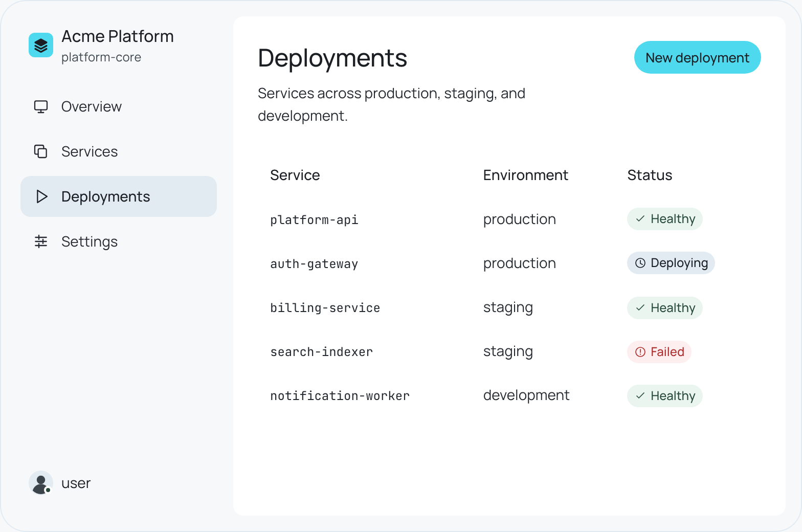

<h1>
  <a href="https://surflane.page">
    <picture>
      <source media="(prefers-color-scheme: dark)" srcset="demo/public/brand/lockup-dark.png" />
      
    </picture>
  </a>
</h1>

React components and design tokens for consoles, dashboards and developer tools. Browse every component, pattern and token in the [catalog](https://surflane.page).

<picture>
  <source media="(prefers-color-scheme: dark)" srcset="docs/images/console-dark.png" />
  
</picture>

## Why Surflane

- **Strict rules.** Hierarchy comes from planes first, then elevation, then borders. Space, size and color come from tokens. A component bends a rule only through a prop or a token.
- **Measured color.** Colors are OKLCH. Every semantic pair states its contrast target, and the catalog measures it in your browser.
- **Korean and English.** Type, spacing and line breaks follow the rules of both languages. The catalog reads in both.
- **Your CSS wins.** Surflane's styles sit in `surflane.*` cascade layers, so a plain rule in your app overrides them without `!important`. Classes are `surf-*` and tokens `--surf-*`, so they never collide with yours.
- **Server first.** Card, Table, Stat and the other stateless parts render as server components and send no JavaScript. Interactive parts build on [Base UI](https://base-ui.com).
- **Tested where you run it.** Every component renders on the server in plain Node. CI builds a Next.js, React Router, Astro and Vite app from every change, and runs the catalog in Chromium, Firefox and WebKit.

## Status

Surflane is pre-1.0. A 0.x minor may rename, remove or restyle parts of the API. The [changelog](CHANGELOG.md) lists each such change with its migration. A patch only fixes.

Breaking changes ship in batches. One minor collects them, so you migrate once instead of every week.

Surflane reaches 1.0 when:

- No rename of a class, token, prop or part is planned.
- Every component has visual regression baselines in both themes.
- CI passes against the lowest and the latest Base UI in the peer range.
- Every component has passed a manual check with VoiceOver and NVDA.

## Install

```sh
npm install @surflane/ui @surflane/design-tokens @surflane/css @base-ui/react
```

Surflane needs React 19 and ships ESM only.

```tsx
import '@surflane/ui/all.css'
import { Button } from '@surflane/ui/button'
import { Input } from '@surflane/ui/input'

<Input name='name' aria-label='Name' />
<Button type='submit'>Save</Button>
```

The [install guide](https://surflane.page/install) writes the setup for your framework, package manager and Tailwind CSS. [Framework integration](docs/frameworks.md) covers Next.js, React Router, Astro, Vite and the cascade layers. [Examples](examples) has a tested app for each framework.

- In server components, use flat part names: `DialogRoot`, not `Dialog.Root`.
- Chart, DatePicker, Markdown, Tree and syntax highlighting have their own entry points. Install their libraries only when you use them; see [optional components](docs/frameworks.md#optional-components).
- Load the fonts once in your app. The catalog uses Manrope, Pretendard, JetBrains Mono and Noto Sans JP from their font packages.
- Your app owns theme persistence, authentication, routing and data.

## Packages

| Package                                      | Holds                                                                                  |
| -------------------------------------------- | -------------------------------------------------------------------------------------- |
| [`@surflane/design-tokens`](packages/tokens) | Tokens and themes as CSS custom properties, and bridges for Tailwind CSS and shadcn/ui |
| [`@surflane/css`](packages/css)              | Classes for controls, layout, presentation and document type that work without React   |
| [`@surflane/ui`](packages/ui)                | React components on Base UI, with data, chart, code and Markdown components            |

The three packages ship together with one version. Each component has its own entry point, named after its catalog page: `@surflane/ui/checkbox` is the [Checkbox](https://surflane.page/components/checkbox) page.

## Catalog

The catalog holds <!-- catalog-counts -->12 foundations, 71 components and 13 patterns<!-- /catalog-counts -->, in English and Korean. Each page shows live examples, the API and keyboard behavior. "Available" means an implementation, example and docs exist. It is not an accessibility certification. Names and data in examples are fictional.

## Contributing

[CONTRIBUTING.md](CONTRIBUTING.md) covers the development setup, the commands, catalog text and releases.

## License

Copyright (c) 2026 ashon. Licensed under either of [MIT](LICENSE-MIT) or [Apache-2.0](LICENSE-APACHE), at your option (`MIT OR Apache-2.0`). Third-party dependencies, including font packages, keep their own licenses.
